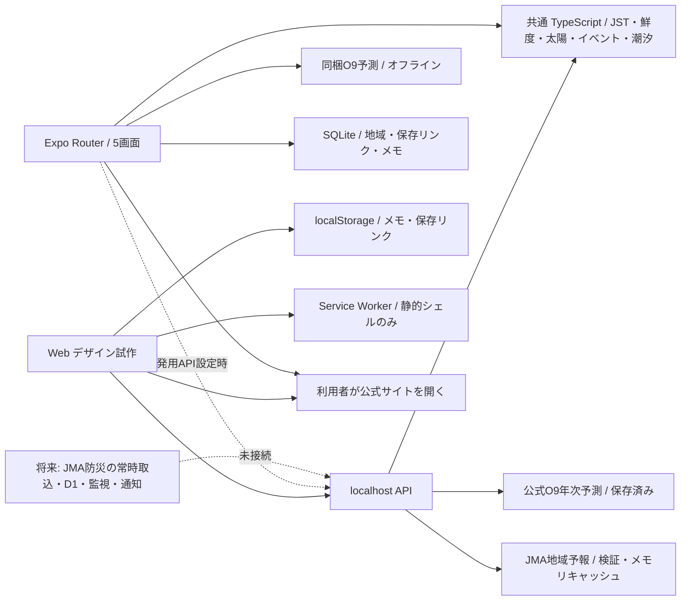

# 構成・API契約

## ファイルと実装境界

|場所|実装内容|
|---|---|
|`packages/core/src/index.ts`|厳密な日付検証、JST、SunCalc、情報鮮度、型分離、正規化イベントの訂正/取消/解除、潮汐固定幅パースと欠損、電話URI、管轄別公式リンク|
|`server/index.mjs`|NodeローカルAPI、モック状態注入、O9アーカイブ、入力検証、120req/分/IP、静的ファイル境界、503/no-store|
|`web/`|操作可能な5画面・2テーマ・雨雲のスタディ、API取得の4秒タイムアウト、保存、外部リンク、ブラウザ履歴によるタブ遷移|
|`apps/mobile/src/app/`|Expo Routerの5タブ。空・失敗・古い・オフラインの状態表示。現在のアプリデータは共通計算と同梱アーカイブ|
|`apps/mobile/src/state.tsx`|設定/メモ/保存リンクの状態とSQLite永続化。WebでSQLiteを使わずlocalStorageへ置換|

WebのローカルAPIとExpoの同梱アーカイブは共通ロジックを使用。Expoにはloopback専用の開発用HTTPクライアントを追加。`EXPO_PUBLIC_API_BASE_URL=http://localhost:4837` の設定時だけ地域予報を取得し、未設定は未接続と表示します。Expo Webで接続を確認する構成で、実機と本番HTTPS APIの接続は未確認/未設定です。NodeサーバーはCloudflare Workerではなく、公開用インフラ・監視・DBは未作成です。

## 共通レスポンス

`Envelope<T>` は `schemaVersion:1`, `mode:demo|reference|live`, `data:T|null`, `source` を保持します。`/v1/weather?mode=live` は実取得または実取得由来のキャッシュをliveとして返します。liveというmodeだけで最新と判断せず、statusとsource.freshnessを確認します。その他はdemo/referenceです。

`source` は `sourceId`, `officialUrl`, `issuedAt`, `fetchedAt`, `checkedAt`, `expiresAt`, `freshness`、必要時 `supersedesId`, `cancelled`, `partial`。発表日時が不明ならnullのまま。アプリで生成した時刻を発表時刻として補完しません。

潮汐は年次の**天文潮位予測**。発表時刻不明のためlive鮮度にはしません。取得証跡・SHA-256・基準面・対象年を別途保持。画面は満干潮の原予測値を表示し、補間値や実況を混ぜません。

|GET endpoint|パラメータ|返却・現状|
|---|---|---|
|`/v1/today`|`area`, `date`, `state`|地域/日付/太陽/潮/デモ天気/unknown防災|
|`/v1/solar`|`area`, `date`|指定代表点のSunCalc参考計算。任意lat/lon APIは未実装|
|`/v1/tides`|`area`, `date`|O9のみ、2026年のみ。他地点・範囲外はnull|
|`/v1/weather`|`area`, `date`, `state`, `mode=demo（既定）/live`|liveは奄美地方460040の地域予報。週間気温は名瀬88837のみ、他地点はnull。demoは従来fixture|
|`/v1/hazards`|`area`|unknown・空events。現在無警報を意味しない|
|`/v1/cyclones`|任意|unknown・coverage unverified。活動中一覧ではない|
|`/v1/transport`|任意|公式リンク。未確認事業者番号は含まない|
|`/v1/places`|任意|空配列。未確認POIを捏造しない|
|`/v1/service-health`|任意|not-connected。実監視ではない|

`area=naze|kasari|koniya`、`date=YYYY-MM-DD`、実在日付のみ。`state=ready|loading|empty|error|stale|offline` はローカルQA用。誤入力400、未知endpoint404、GET/HEAD以外405、取得失敗fixture503、流量超過429/Retry-After。常時ポーリングはしません。live天気を要求したときだけ固定JMA URLを取得します。年次アーカイブは起動時に1回読み込み。速報APIはno-store、Service Workerは`/v1/`をキャッシュしません。

## イベントモデルの限界

地震履歴、EEW、津波、気象警報、台風は別kind。キーはkind/eventId/regionCode。revisionで順序を確定、同一revisionの競合は拒否、取消・解除を削除せず保持します。**これは正規化後の単体ロジック**であり、実JMA XMLを完全に取り込むアダプターではありません。フィード全体の欠落検出・区域コード表更新・初期現行状態の確立・永続履歴は未実装です。

## 本番へ進める条件

JMAの2026年改訂を反映したXMLスキーマと訓練fixture、訂正/取消/区域別の統合、取り逃し検知、再取得の上限・バックオフ、ETag/キャッシュ、ソース停止監視、現行状態の出典を揃えます。公式の高頻度フィードは毎分、長期フィードは毎時更新で、停止や遅延があり得ます。[気象庁PULL仕様](https://xml.kishou.go.jp/xmlpull.html)

外部サービス、Cloudflareリソース、APNs/FCM登録、GitHub remoteは承認後。登録名義や課金、秘密鍵をコードへ組み込みません。

## 地域予報の取得・キャッシュ契約

`server/weather.mjs` と `packages/core/src/weather.ts`。公式URL `https://www.jma.go.jp/bosai/forecast/data/forecast/460100.json` の**実応答内**から奄美地方 `460040` を選びます。URL/office名だけで区域を推測しません。短期/週間/降水の各timeDefinesを独立に扱い、空文字はnull、降水0%は0。短期の重複/非時系列の気温は未採用。climatology/tempAverageは予報へ混ぜません。週間の名瀬最低/最高だけ別フィールドにします。笠利/古仁屋の実況へ流用しません。

サーバーの最初の要求で取得、以降1時間メモリキャッシュ、同時取得は1本へ統合。4秒のタイムアウト、512KiBの上限、リダイレクト拒否、入力検証、未来発表/旧版への巻き戻り拒否。失敗時は1分バックオフ、最後の成功値・fetchedAtを維持しrefresh-failed/stale。初回失敗は503/unavailable/data:null。メモリキャッシュは再起動で消え、永続キャッシュ/ETag/ソース監視は今後です。

`status=ready|empty|stale|unavailable|refresh-failed`。選択日が予報範囲外ならempty。`issuedAt` は該当日の採用系列の最も古い発表、系列ごとの時刻もdata.reportTimes等へ保持。expiresAtは発表+6時間の**アプリ鮮度基準**で、気象庁の有効期限ではありません。Web/Expoは開いたままでも毎分表示の古さを再評価し、毎分JMAを取得しません。

選択地域/日付/GPS/メモをJMAへ送信せず、固定の公開URLだけを読みます。開発中の別portのExpo Web用にloopback OriginのみCORS許可。`/v1/`はno-storeでService Workerの対象外。地域予報は現在気温でも災害警報でもありません。現在の大温度・絵はデザイン用デモとして明示しています。

## 公式XMLの実サンプル検証

`server/jma-xml.mjs` は名前空間を確認してAtomと種類別XMLを解析し、EventID/Serial（空はnull）/InfoType/発表/有効期限/区域コードを保持。地震の震度不明はnull、EEWコードは履歴に混入させず、取消を削除しません。訓練はoperational:false。XMLのDOCTYPE/entity、深すぎる/大きすぎる入力、外部URL、重複Head、不正スキーマは拒否します。

VXSE51/52/53・VTSE41・VPTW61・VPWW53/54が今回の対応対象。`scripts/inspect-jma.mjs --fetch` は長期Atomから種類別サンプルを一度取得するローカル検証コマンドです。サンプル抽出を全件収集や現行状態と扱いません。APIのhazards/cyclonesは引き続きunknown、UIへ実警報を配信していません。永続化・2026年の全新電文・全区域の辞書・初期状態・欠落検知・現在状態の統合が必要です。

## 0.3.0の追加

`GET /v1/observations?area=naze|kasari|koniya&date=YYYY-MM-DD`：公式AMeDASのlatest_time→国全体mapを最大2MiB/合計4秒制限で読み、固定3観測所を抽出。現在JST日のみ、品質0のみ。取得10分/失敗1分、観測20分を鮮度基準。source.issuedAtはnull、data.observedAtを観測時刻として表示。最後の成功キャッシュの元fetchedAtを保持。APIテストfixtureは全国mapの3地点抽出で、原map全体のSHAは別のprovenanceに記録。

`AMAMI_API_ONLY=1`で実予報/観測/サービス情報だけを返し、Web/デザイン/デモ/未統合防災を除外。これは本番ホスティング/監視/共有キャッシュ/TLSを完成させるものではありません。クライアントはローカルビルドでloopback/LAN HTTP、公開ビルドで構文検証したHTTPS originに限定。公開設定に鍵やメモを含めません。

## 0.3.1の共通ロジック

packages/core/src/usage.ts：公式リンクの語彙/カテゴリ/自治体検索、次の潮の選択、未完の6時間降水確率枠、保存書込の直列化。weather.tsは表示項目の発表時刻を保持し、未表示の週間値で短期予報の鮮度を下げない。NativeのWeatherProviderは要約/詳細で同じ取得結果を共有し、同じ地域/日付の更新失敗時はセッション値を残す。気象の端末永続キャッシュは未実装。
