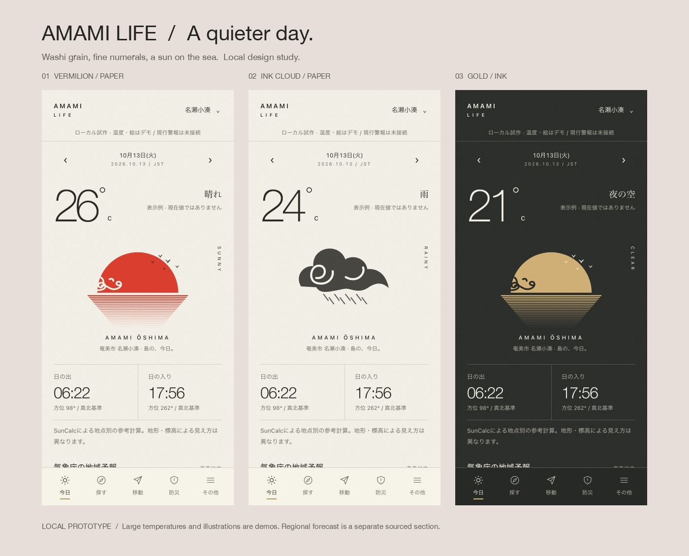

# AMAMI LIFE / 実装・検証報告

## 最新: 0.3.2 Web公開

> 2026-10-14更新: Web0.3.2はユーザー承認で公開済み。GitHub/Cloudflare本人不一致は専用認証で解消。現在のWeb構成と復旧は [SHIMACRAFT_WEB_RELEASE.md](SHIMACRAFT_WEB_RELEASE.md)。以下の旧記述はストア版/過去の準備記録として読み、未公開のストア版と混同しないでください。

全78試験、Lint、strict型検査成功。ブラウザ8サイズで横はみ出しと主要情報の隠れを確認。本番20HTTP項目成功。元Workerは保持し制作案内は/studio。公式気温/予報はCloudflare実取得。以下は以前の各段階の記録です。

2026年10月13日〜14日、JST。ローカル開発の進捗です。公開判定は未達です。

## 1. UI比較

|案|考え方|状況|
|---|---|---|
|A / Editorial|既存パッケージの紙と深緑、ガイドブックの編集|比較基準として保持。旧v0.3のUIではない|
|B / 朱と和紙|細い大数字、和紙、日輪、波の反射、墨雲、静かな余白|添付の雰囲気に近い採用候補。操作可能な新5画面|
|C / 墨と金|墨色の地に金の日輪、落ち着いた夜の計器|Bと共通構図の夜版。独立した第三のデザインシステムとは数えない|

独立方向性はA/Bの2系統、比較案は3つ。375×667 /390×844 /430×932を実寸確認して保存。Bの全5タブ×6状態=30枚、Cの5画面、雨雲、文字200%、タブレット/横画面、Expo共通5画面も保存しました。[比較ギャラリー](../design/review.html)

ユーザーの継続指示によりB「朱と和紙」＋C「墨と金」を採用しました。公開の承認とは別です。参照画像のフォント名は不明で、完全一致の同定はしていません。WebはHelvetica Neueの細字とシステム日本語、NativeはOS字体を基準としています。iOS/Androidの字幅・質感の実機一致は未確認です。

UI Pocketの公開サムネイル15画面を中心に研究。認証後の全画面/実アプリの遷移は未検証。Apple HIG/Material 3/JDD日本語UI記事の閲覧内容は [デザイン調査](../research/DESIGN_RESEARCH.md) に記録しました。外部の人間デザイナーレビューは受けていません。

## 2. 機能の実装状態

|機能|状態|検証範囲|
|---|---|---|
|Expo SDK57 / TypeScript / 5タブ|implemented|strict/Lint、iOS・Android・Webのバンドル生成、Expo Webの起動/タブ遷移|
|地域・日付・JST|implemented|名瀬小湊/笠利/古仁屋、前後日、閏日、海外TZ|
|太陽・方位角|partial|NAOJの3地点・2026-10-13に対し2分/1°以内。通年/実視認は未検証|
|潮汐|implemented（限定）|O9の2026年365日。複数満干・欠測null・時刻ゼロ埋め・翌日補間の単体試験。別地点に流用しない|
|天気・風・波|partial（実接続）|共通API経由で公式奄美地方予報をWeb/Expo Webへ表示。1時間キャッシュ/4秒制限/発表時刻による古さ/失敗を試験。大温度は3観測所の公式実況へ置換。絵は島の装飾|
|地震・津波・台風・気象警報|partial / external-link|別型・鮮度・正規化reducer、公式実XML解析と取消/訂正試験。現行状態統合/常時取込は未接続|
|空港/船/バス|external-link|奄美空港/A''LINE/マリックス/しまバス。運航を独自判定せず、スクレイピングなし|
|ハザード/避難|external-link|奄美市ハザード/一時避難場所、古仁屋選択時は瀬戸内町。GIS/避難ルートはなし|
|電話|partial|110/119の確認画面と電話URI。実発信未試験。事業者13件は確認未了で非公開|
|検索|partial|観光を含む公式情報の横断検索・カテゴリ閲覧。観光案内所/マップ/タクシー案内を追加。店舗/設備POIは未掲載|
|保存・メモ|partial|Web保存/再読込/サーバー停止試験成功。Native SQLite実装済み、端末での保存は未試験|
|オフライン|partial|Web静的シェル/リンク名/メモのサーバー停止試験成功。Nativeは太陽/潮/リンクを同梱。端末圏外試験は未実施|
|通知|future|許可要求・Push登録・送信なし。EEW秒保証/OS速報代替なし|
|公開・外部サービス|許可待ち|push/PR/deploy/新規リソース/ストア登録・配布・公開は未実施|

Phase 1の土台とUI、Phase 2の太陽/潮・監査・公式導線、Phase 3の保存/オフラインの一部まで進めました。Phase 2/3全体を完了したとはしていません。

## 3. 出典の確認

気象庁O9の公式テキストを1回取得し、50,005バイト・365日、旧保存データとSHA-256が一致。10/13の満潮08:01/203cm・19:26/205cm、干潮01:30/27cm・13:41/86cmを公式表と照合しました。原発表時刻は不明です。取得時刻と対象年を保持し、実測/ライブと扱いません。[気象庁潮位表](https://www.data.jma.go.jp/kaiyou/db/tide/suisan/suisan.php?stn=O9)

既存天気URL `460100.json` の実応答に奄美地方 `460040` と名瀬 `88837` が含まれることを確認。区域一覧のoffice名だけから応答対象を推測しないこと。実応答の記録は `research/jma-weather-scope-proof.json`。公式予報の実取得・時刻軸の正規化・Web/Expo Web表示を追加しました。短期の非時系列/重複気温の意味は未検証のため未採用。週間気温は名瀬だけに表示し、平年値は混ぜません。1時間メモリキャッシュ、取得失敗時の元fetchedAt保持、発表+6時間の古さ表示を試験。これは気象庁の有効期限ではなくアプリの鮮度基準です。

防災はJMAの2026年更新一覧と一部通知を確認。地震・津波・台風・新旧気象警報の公式5サンプルを保存して解析し、種類別の実サンプル4件を検証コマンドで取得しました。取消/訂正/訓練は保存電文を変形した合成fixtureも使用。全電文スキーマや長時間収集、現在の警報状態を検証済みとはしていません。交通のverifiedは公式リンクの確認で、ライブ転載/API契約の承認を意味しません。[更新一覧](https://xml.kishou.go.jp/revise.html)

[更新したデータ台帳](DATA_SOURCE_REGISTRY.csv) はverified / permission-pending / not-verifiedを区別。原仕様の台帳は `specification/` にそのまま保存しています。

## 4. 変更範囲・構成

今回の成果物はこの `outputs/amami-life` 内。主な新規ファイルは `web/`、`packages/core/src/`、`server/`、`apps/mobile/src/`、`tests/` と監査/比較資料。原キットと既存サイトのコードは変更していません。

[構成図と全ローカルAPI契約](ARCHITECTURE.md)、[旧コード監査](LEGACY_AUDIT.md)、[Issue相当のタスク](TASKS.md) を保存しました。デプロイ用Worker/D1/通知サービスは未作成です。

## 5. 実行した検証

|実行・確認|結果|限界|
|---|---|---|
|`npm test`|64/64成功（従来51＋観測9＋公開設定/API限定3＋公式リンク1）|公式全電文や実配信を保証しない|
|`npm run typecheck`|成功、TypeScript strict|端末実行の代替ではない|
|`npm run lint`|成功、0 errors|自動チェックの対象範囲内|
|`npm run build`|成功、Web共通モジュール約24KB|圧縮配信や実端末の性能計測なし|
|`expo export --platform all`|成功。iOS/Android Hermes・Web生成|ipa/apkの署名/インストール/実機起動ではない|
|`expo install --check`|offlineモードではup to date|ツール自体がoffline検証の限界を警告。公開前にオンラインDoctor等が必要|
|旧パーサーの既存テスト2本|成功|限定fixture。取消・全2026仕様の網羅なし|
|375/390/430px|A/B/Cの実寸確認、横はみ出しなし|Aは430pxで元の比較用紹介部分が表示される|
|5タブ×6状態|30枚保存、未知/失敗から安全/無警報を表示しない|ローカル状態注入試験|
|文字200%、768×1024/1024×768/667×375|設定/防災で横はみ出しなし|全ページ/全OSの200%試験ではない|
|検索・地域・保存・メモ・再読込|操作確認成功。観光カテゴリのみでも3件閲覧可能|自動E2Eスイート化は未実装|
|ローカルサーバー停止→再読込|保存リンク/メモの閲覧、取得失敗表示を確認|機内モード・圏外の実機試験ではない|
|電話確認とEscape|確認ダイアログ開閉成功、tel:110を確認|電話アプリ起動/通話は行っていない|
|Webガイドライン|ラベル/焦点/文字/URL/拡大/配色をレビューし修正|VoiceOver/TalkBack/色覚・屋外/実機safe areaは未実施|

0.3.0証跡：`research/all-tests.txt`、`research/typecheck-v030.txt`、`research/lint-v030.txt`、`research/native-export-v030.txt`、`research/amedas-source-check.json`。以前の段階の証跡：`typecheck.txt`、`lint.txt`、`expo-export.txt`、`expo-dependency-check.txt`、`nao-*.txt`、`design/screenshots/*checks.json`。

依存監査：`research/npm-audit-final.json`（初回も同件数） は **29件（18 high/11 moderate）**。直接の4アドバイザリから親依存へ伝播した件数です。braces ≤3.0.3、node-forge ≤1.4.0は公式アドバイザリで修正版なし。decode-uri-component、uuidも残っています。`npm audit fix --force` がSDKの大幅変更/ダウングレードを示すため実施せず、互換性と到達可能性を含め公開前の課題にしました。脆弱性0とは報告していません。[braces](https://github.com/advisories/GHSA-vfj7-8cjw-p6xm)、[node-forge](https://github.com/advisories/GHSA-86w9-cpqp-85rv)、[decode-uri-component](https://github.com/advisories/GHSA-vcc3-ghjq-m6fr)、[uuid](https://github.com/advisories/GHSA-w5hq-g745-h8pq)

## 6. 未解決・次の確認

公開対象範囲、既存サイトの本番一致、天気の継続監視、防災の現行状態統合、事業者確認、全自治体/POI、通知、ネイティブ保存と実機/読み上げ、依存脆弱性、規約・窓口・登録名義が未解決です。

ネットワーク制約下の最初の `gh auth status` は本人確認に使えませんでした。その後GitHub APIの読み取りで `camiordersystem-maker` を確認。ユーザー指定も既存remote所有者も `shimacraft8`。同名の保存認証でも本人照会はcamiordersystem-makerのままで、解消していません。既存サイト変更、push、外部リソース作成、デプロイ、一般公開は確認後です。

費用・工数の条件付き目安、個人名の表示、Googleテスト要件、承認対象は [公開ゲート](RELEASE_GATES.md) に記載。今回サービス契約や課金はしていません。

## 続行分の引き継ぎ

[次の開発順序](NEXT_ROADMAP.md)、[実機確認手順](DEVICE_QA.md)、[公開手順](PUBLICATION_RUNBOOK.md)、[素材一覧](../design-system/ASSETS.md)を追加。色は `design-system/tokens.json` をNativeが参照し、Web CSSをビルド生成する共通化を実施。字体・質感・図柄と5タブを維持しています。

台風以前は公式天気図のTD表記と予想図へ導く方式を追加。JMAの24時間以内発達見込みの範囲を超えた全TDの網羅や独自発生予報は実装していません。JTWCは公式ページ取得403で、提供/転載条件未確認のため未採用です。

`npm run package` はソース・素材・設計・データ/試験証跡を上位outputsのZIPへ梱包し、全ファイルのSHA-256とZIP CRCを検証します。node_modules/.git/.expo/秘密設定・鍵は除外。ソース配布用で、ipa/apk/aabのインストーラーではありません。

## 0.3.0 / 初版の公開準備（10月14日追記）

- 名瀬88837/笠利88821/古仁屋88901の公式観測を追加。最新時刻→固定map URL、国全体の応答から3地点だけ抽出。温度の品質0以外・欠測・文字列・範囲外はnull。太陽/潮の代表地点と観測所の座標を分離。
- 上流取得10分キャッシュ、20分鮮度、更新失敗時は元の観測/取得時刻を保持。古い・失敗・未取得・過去未来対象外の試験。Nativeは同じ画面の再取得失敗時にセッション内の値を古い表示で保持。端末への天気永続キャッシュは未実装。
- ホームの固定デモ温度を除去。島の日輪は装飾と明記。公開バンドルで開発状態切替を非表示。昼夜・5タブ・字体/紙/細線の構成を維持。
- 独自アイコン5素材、昼夜スプラッシュ、EAS preview/production、必須公開設定チェック、API-onlyモード、プライバシー/利用案内をローカル実装。未使用の新規Expoスターター素材を整理。登録・署名・配布・API公開・窓口公開は未実施。
- 実観測の3地点API応答、公式取得fixture/SHA、Expo Webでの390px昼夜、未来の日付で実況非表示、設定の開発項目非表示を確認。Web版は390/320pxの横幅検査。端末の実機ではありません。
- 依存監査を再取得：npm-audit-v030.jsonは29件（18 high/11 moderate）。forceによるSDK44への変更等は未実施。到達可能性・許容判断は未完。

公開阻害事項と本人の登録手順は [STORE_RELEASE.md](STORE_RELEASE.md)、掲載文/申告資料は [STORE_METADATA.md](STORE_METADATA.md)。ストア審査・実機確認が終わるまで公開可能とは判定しません。

最終リンク点検でNativeの観光ドメインが別の許可一覧から漏れていた不備を修正。許可先を共通公式リンク台帳から導出し、全公開リンクと偽装/HTTP/認証付きURLの回帰試験を追加しました。

## 0.3.1 / iPhone優先の利用者操作レビュー

詳細は [USABILITY_REVIEW_IPHONE.md](USABILITY_REVIEW_IPHONE.md)。ホームに予報/雨/次の潮を集約、普通の旅行語彙での検索、メモ自動保存と書込直列化、今日への復帰、地域ダイアログ、表示項目に基づく予報の鮮度、交通/防災の優先導線、電話確認の共通ダイアログを改修しました。

自動試験は71/71成功、strict/Lint/Webビルド/3プラットフォームのバンドル生成成功。Expo Webで検索・保存・再読込・管轄・確認キャンセル・API停止/再開・4画面幅を操作確認。旧64件の表は0.3.0時点の記録です。新証跡はresearch/usability-v031/、research/all-tests.txtは最新71件。

iPhone実機/iOSシミュレーターは未実施。simctl不在を確認。元サイト/外部サービス/公開状態は変更なし。依存29件と公開阻害事項は未解決です。
