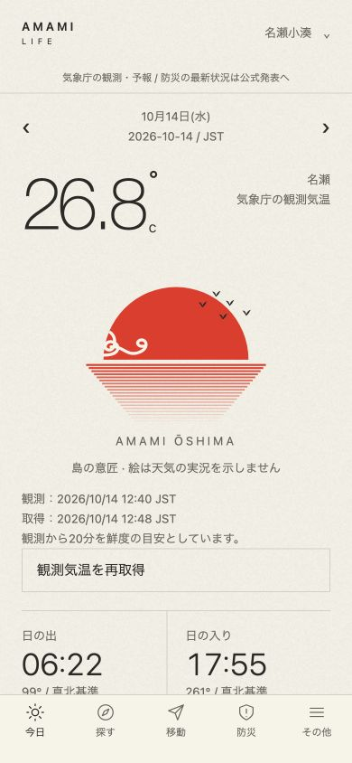
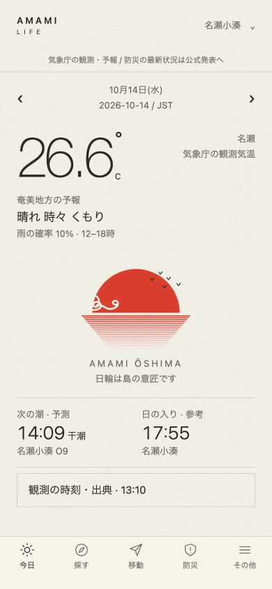
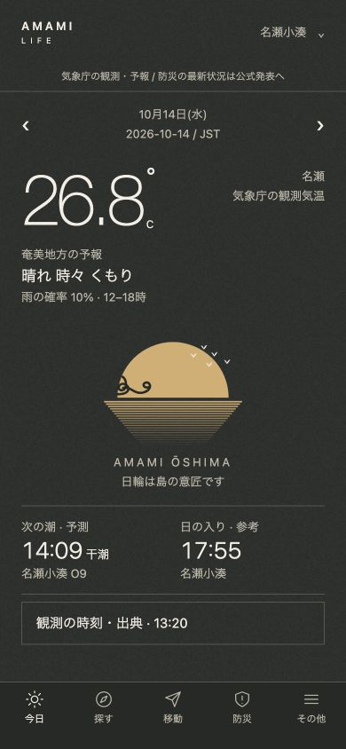

# iPhone優先・利用者操作レビュー / 0.3.1

2026-10-14 JST。旅行者・島民の用途を想定し、Mac上のExpo Webをブラウザで操作して改修しました。**iPhone実機・iOSシミュレーターでの試験ではありません。** このMacはCommand Line Toolsのみでsimctlが見つかりません。外部の人によるユーザーテストでもありません。

## 改修した不備

|優先|操作時の問題|修正|
|---|---|---|
|P1|ホームの最初の画面に天気予報・潮がない。時刻/再取得/装飾で押し下げられていた|気温の直下に奄美地方の予報と時間帯付き降水確率。日輪の後に次の潮・日の入り。詳しい観測出典は開閉式。小画面では日輪の高さを調整|
|P1|「飛行機」で空港が見つからない。「すべて」の初期表示も観光3件だけ|飛行機/船/ふぇりー/全角ASJ等を公式リンクに対応。「すべて」は選択地域に関連する全公式情報、検索条件のリセットを追加|
|P1|未保存メモが再読み込みで失われる|入力時の自動保存と保存中/成功/失敗の表示。保存処理を直列化し、古い書込が最新メモを上書きしない。保存ボタンは再試行用にも残す|
|P1|今日への移動と地域変更が分かりにくい|ロゴ/今日タブで現在JST日に戻る。別日には明示的な「今日の日付に戻る」。地域は画面を離れず選ぶダイアログ|
|P1|未使用の古い週間発表に引きずられて新しい短期予報も古く表示|実際に表示する予報項目だけの発表時刻を選ぶ。表示中の週間気温が古ければ、その古さは維持|
|P1|予報を更新できないと画面の保存済み値まで消える|同じ地域/日付のセッション内保存値を保持し、更新失敗・古い予報と区別。観測/予報のエラーには画面内の再取得操作を用意|
|P1|Expo Webでは緊急番号の従来Alertが表示されない|共通の確認ダイアログに変更。番号と発信操作を明示し、発信せず閉じられる。試験中は実発信していない|
|P2|移動・防災の必要な公式情報が装飾や順序で探しにくい|移動の大きなASJ装飾を整理。防災は津波/気象警報を先に、自治体の避難情報を別見出しへ。古仁屋では瀬戸内町のみを案内|
|P2|見出し・保存通知・大きい文字の扱い|日付h1/詳細h2の意味付け、保存通知のlive region、文字拡大時の縦積みと予報の全文表示を実装。実機の読み上げは未確認|
|P2|アプリ版プレビューの深いURLを再読込すると404|専用のloopback静的サーバーで既知の画面URLを正しく返す。起動用commandを追加|

朱と和紙/墨と金、Helvetica Neue系の細字、和紙の粒子、日輪/水平反射/鳥/墨雲、5タブは維持。新しいカード装飾や外部写真は追加していません。観測気温と地域予報を区別し、日輪は装飾であることを明記しています。

## 自動試験

**71件成功、失敗0**。従来64件に、検索/地域、次の潮と日またぎ、降水確率の時間帯/ゼロ/未取得、表示項目別発表時刻、保存順序/失敗後の再試行の7件を追加。TypeScript strict、Lint、Webビルド、iOS/Android/Webのバンドル生成も成功。

バンドル生成は署名済みipa/apk/aabの作成・インストール・実機起動ではありません。

## ブラウザで実操作した範囲

- 空港を「飛行機」、フェリーを「船」で検索。全件一覧15件、船2件。カテゴリと検索条件のリセット。
- 空港リンクを保存→設定で閲覧。メモを保存ボタンなしで入力→再読み込みで復元。検証用のメモ/リンク追加は元に戻した。
- 未来の日付から今日へ戻る。地域ダイアログとEscapeで閉じる操作。
- 古仁屋で名瀬小湊の潮を流用せず「未連携」。瀬戸内町の避難情報を表示し、奄美市のハザードを混ぜない。
- 119の確認画面→発信せず閉じる。電話アプリ起動・通話は未試験。
- 自分のローカルAPIを一時停止。同じ画面を開いたままの再取得では保存値と通信エラーを区別。再読込後は実況を「—」にし、同梱の潮と保存メモ/リンクは使える。API再開後に再取得成功。
- 320×667/375×667/390×844/430×932の標準文字で横はみ出しなし。取得した予報の内容では、次の潮の時刻も下部タブより上に表示。すべての文言長/文字倍率/実機safe areaで同じ位置を保証しない。
- 新しい最終確認タブの通常操作ではブラウザwarn/errorなし。通信断試験の接続エラーは意図した結果。

証跡は `research/usability-v031/interaction-results.json`、`screen-size-results.json`、`tests.txt`、`typecheck.txt`、`lint.txt`、`export.txt`、スクリーンショットです。操作結果の件数と単体試験の件数は別です。

## 画面の確認

改修前：

改修後：

画像の気温は撮影時の実観測で、改修前後で値が変わることがあります。アプリの不変のサンプル値ではありません。潮は2026年O9の天文潮位予測です。

## 残る確認

iPhone実機でのOS文字拡大、VoiceOver、ノッチ/ホームバー、キーボード、長文メモ/保存失敗/OS再起動後のSQLite、背景復帰・日またぎ、圏外からの復帰、外部リンク/電話連携、電池・通信量・性能、アイコン/起動画面、署名/配布は未確認です。シミュレーターも未使用。

気象の端末永続キャッシュは未実装で、アプリの再起動時に圏外の観測値を復元できるとはしません。運航や警報は公式リンク主体、現在状態の常時統合・通知・POI地図・事業者の直接電話帳は未実装です。前回依存監査の29件は未解決（今回依存バージョン変更なし、再監査はしていない）。

Appleストア未登録、GitHub本人不一致、公開API・窓口未確定も継続。push/デプロイ/ストア提出/一般公開は実施していません。

## 参照

Expo SDK57の公式文書、実装後に取得した[Web Interface Guidelines](https://raw.githubusercontent.com/vercel-labs/web-interface-guidelines/main/command.md)、既存MASTERとApple HIGの先行調査を参照。今回Apple HIGの本文再取得はWeb取得ではできなかった。UI/UXスキルの追加検索に直接適合する新方針はなく、既存の意図と実操作の問題を優先。

避難場所/避難所の区別は[内閣府](https://www.bousai.go.jp/taisaku/hinanbasyo.html)の説明を参照。指定されていることから開設中とは推測しない。
